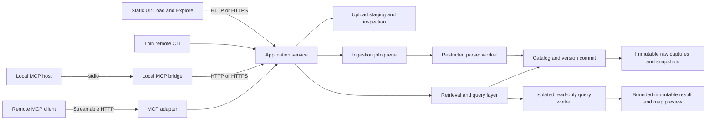

# Service, guided loading, and exploration roadmap

This document describes a roadmap for making Moses usable by people who do not write code. It records local behavior separately from proposed service, UI, and MCP work. The [local read-only service](local-service.md) now implements authenticated catalog retrieval with opaque IDs; explicit primitive import recipes and conservative format signatures are also implemented locally. The static catalog GUI now supports browsing, history, bounded table/map previews, feature inspection, comparison and downloads. Upload/job execution, guided loading, deployment packaging and MCP below remain designs.

The UI also includes a planned **Explore** workspace: a lightweight DuckDB-style SQL editor, a results table, and a geospatial map with multiple layers. The [SQL and map exploration feature plan](query-map-workspace.md) defines the experience, technical contracts, implementation slices, and acceptance criteria. Single-version dataset mapping is implemented locally in #23; multilayer exploration belongs with the local loader; interactive SQL and query-result layers follow the service foundation and precede hosted access and MCP.

## Current baseline

Moses is a local Python CLI and library with an authenticated read-only loopback API. `Catalog` stores immutable raw captures and Parquet/GeoParquet snapshots under a warehouse directory, with SQLite indexing accepted versions. A failed import does not advance the current-version pointer. The code is an early MVP: its dependency set includes DuckDB, PyArrow, Pyogrio, Shapely, and PyProj, and catalog imports are eager. It has a same-origin read-only catalog GUI, but no durable upload/job execution, thin remote client, or MCP integration.

This turn adds a narrow tabular and inspection path:

- CSV and TSV can be loaded as text by default. An optional conservative full-column inference pass recognizes only unambiguous booleans, int64 values, and finite floats. Empty cells, date-like values, mixed values, and leading-zero identifiers stay strings.
- Plain Parquet is supported alongside the existing vector formats.
- `moses inspect` performs a non-mutating, full-file read and reports format, schema, row count, preview, CRS, and possible coordinate field pairs. It does not infer geometry from coordinate names. Supported suffixes or explicit format choices are checked against conservative content signatures before reader validation.
- `--type FIELD=TYPE` applies explicit string, bool, int64 or float64 choices with full-row validation. New accepted manifests record a versioned recipe, effective CRS and its origin. Empty strings become null only for explicitly selected non-string primitive types; the recipe records this rule.
- `moses init --default-crs EPSG:...` stores a validated default in `<warehouse>/config.json`; `MOSES_DEFAULT_CRS` takes precedence over that setting. This is a fallback for geometry that lacks CRS metadata and is ignored for nonspatial tables.

Inspection is not yet a lightweight metadata-only or sampled scan. It materializes the full table, and ingestion/materialized hashing can hold substantial memory. The current local `query` disables external access in DuckDB, but that setting alone is not a complete resource-isolation boundary for remote or multi-user operation. Catalog manifests currently expose filesystem paths; those paths must never become remote API resources.

## Target shape

Keep the normalizer and immutable version contract in the service, and put a small guided client in front of it. A local service can bind to loopback and serve a static UI and JSON API from one process. The browser must call that localhost API: a page opened with `file://` cannot safely or portably read arbitrary user files. The same service API can later be deployed behind a reverse proxy for team access.



For the first release, run one service instance against one persistent local volume. Keep upload staging, parser scratch space, catalog database, raw captures, and accepted snapshots on that volume, with explicit size and retention limits. A worker should validate into a new staging area and publish a version only after all checks succeed. The current catalog can remain the acceptance index initially; the service should make its own storage/resource abstraction so SQLite paths and implementation details stay private.

## Guided loading experience

The user chooses a file in the browser, uploads it, and receives an opaque upload ID plus a content hash. Inspection presents the detected format and layer, complete schema, row count, bounded preview, coordinate candidates, CRS and its source, and actionable warnings. The user can choose a layer, coordinate columns, a CRS assignment, a dataset name and key, and explicit type overrides. The service validates the complete input with those choices, reports validation errors, then starts an ingestion job. A successful job returns an accepted dataset version and a summary. Until the full validation and snapshot write succeed, the previous accepted version stays current.

Inspection suggestions and accepted schema have different roles. Sampling may be useful for quick previews in a later implementation, but schema and constraint validation must cover every row before acceptance. Type choices should be recorded in a versioned import recipe so a rerun is explainable. A later schema-drift policy can require review when the source schema changes; it must not silently coerce an accepted dataset. Reprojection, geometry repair, and key selection should be explicit user choices.

## Format, schema, and CRS policy

Content detection now uses the supported format allowlist, conservative signatures and suffixes, with explicit reader selection and mismatch rejection. Primitive column overrides validate the full input. A broader schema/null-policy contract, schema-drift handling and isolated resource budgets remain future work. Do not enable arbitrary GDAL drivers or ask GDAL to discover remote resources. ZIP inputs need limits on compressed and expanded size, member count, nesting, and path names before extraction before they are exposed through remote ingestion.

The CRS choice order for geometry is:

1. A valid CRS embedded in the source.
2. A user-supplied CRS assignment for a source with no CRS. If that conflicts with an embedded source CRS, fail and ask the user to resolve it.
3. `MOSES_DEFAULT_CRS` or the warehouse config as a fallback for missing CRS.
4. A legacy EPSG:4326 default for CSV coordinates when no explicit or configured CRS applies.

The warehouse-level default should apply only when geometry lacks a CRS. It must not override source metadata, imply reprojection, or guess a projected CRS from coordinate ranges. Keep the selected CRS and its origin in the import recipe and accepted version metadata. GeoParquet writes should retain explicit CRS metadata, including explicit unknown CRS where necessary.

## Service API target (partially implemented)

See [local service](local-service.md) for the implemented read-only routes and
limits. The write and Explore operations in this table remain proposed contracts.

Use JSON for control data and streamed binary bodies for source files. Give each upload, inspection, ingestion, job, dataset, and version an opaque server-owned ID. IDs are scoped to the authenticated owner in a hosted service. Operations that create resources accept an idempotency key so retries do not duplicate a large upload or publish multiple versions.

| Operation | Purpose |
| --- | --- |
| `POST /v1/uploads` | Create an upload slot and return an ID plus an upload URL or streamed upload route. |
| `PUT /v1/uploads/{upload_id}/content` | Stream file bytes; enforce size and hash limits while writing to staging. |
| `POST /v1/uploads/{upload_id}/inspections` | Inspect an uploaded source with optional layer/reader hints. |
| `GET /v1/inspections/{inspection_id}` | Read detected format, schema, preview, CRS, and warnings. |
| `POST /v1/ingestions` | Validate selected options and create an asynchronous ingestion job. |
| `GET /v1/jobs/{job_id}` | Poll job state and retrieve a validation report or accepted version result. |
| `GET /v1/datasets` | List datasets visible to the caller. |
| `GET /v1/datasets/{dataset_id}/versions` | List immutable accepted versions. |
| `GET /v1/datasets/{dataset_id}/versions/{version_id}` | Read schema, CRS, counts, hashes, and provenance for one version. |
| `GET /v1/datasets/{dataset_id}/versions/{version_id}/preview` | Return a bounded row preview from an exact version. |
| `GET /v1/datasets/{dataset_id}/versions/{version_id}/download` | Stream an authorized accepted snapshot or raw capture. |
| `POST /v1/queries` | Start an isolated, read-only query against pinned accepted versions in Phase 2a. |
| `GET /v1/queries/{query_id}` | Read query state, resolved input versions, and the retained result ID. |
| `POST /v1/queries/{query_id}/cancel` | Cancel queued or running work and release worker resources. |
| `GET /v1/results/{result_id}/rows` | Page through a bounded, retained result without reexecuting SQL. |
| `POST /v1/map-previews` | Create a bounded map preview from an authorized dataset version or query result. |
| `GET /v1/map-previews/{preview_id}` | Retrieve display geometry, CRS/provenance, bounds, and omissions. |

The [Explore API contract](query-map-workspace.md#proposed-api-additions) also covers capabilities, result downloads, saved workspaces, and preview job completion. Dataset map previews start in Phase 1; query-result previews require Phase 2a.

Example upload and inspection:

```http
POST /v1/uploads
Authorization: Bearer <token>
Idempotency-Key: 7d4a...
Content-Type: application/json

{"filename":"trees.csv","content_length":18420}
```

```http
PUT /v1/uploads/upl_opaque123/content
Authorization: Bearer <token>
Content-Type: text/csv

<streamed file bytes>
```

```http
POST /v1/uploads/upl_opaque123/inspections
Authorization: Bearer <token>
Content-Type: application/json

{"format":"csv","preview_rows":10}
```

Example reviewed ingestion request:

```http
POST /v1/ingestions
Authorization: Bearer <token>
Idempotency-Key: 238b...
Content-Type: application/json

{
  "upload_id":"upl_opaque123",
  "inspection_id":"ins_opaque456",
  "expected_source_sha256":"<hash returned by inspection>",
  "dataset_name":"street_trees",
  "key":"tree_id",
  "options": {
    "x":"longitude",
    "y":"latitude",
    "crs":"EPSG:4326",
    "types":{"tree_id":"string","diameter":"float64"}
  }
}
```

Seal uploaded bytes before inspection. Bind each inspection to their hash and canonical parsing options; reject an ingestion if either differs from the reviewed inspection, requiring another inspection for changed choices. Return `202 Accepted` with a durable `job_id`; the job result should identify the accepted version only after the catalog commit. Validation failures should return stable machine-readable error codes and row/field context where safe. Never accept a local path, SQL file path, arbitrary URL to fetch, or raw catalog manifest path as an API resource. The initial remote API should not expose arbitrary SQL. Enable the constrained query surface locally in Phase 2a only after resource limits, version pinning, and isolated execution pass acceptance; hosted access additionally requires Phase 3 ownership checks. A SELECT-prefix check is not a sandbox.

## Packaging and deployment

Split packaging into a small `moses-client` and a server/local processing distribution such as `moses-geo`. The client should use the standard library or a small HTTP dependency and support upload, job polling, metadata retrieval, and download without installing GDAL/Pyogrio, DuckDB, Shapely, or PyArrow. The server and local CLI can retain native dependencies. Lightweight remote retrieval should not import `Catalog` or the full parsing stack eagerly. Local connectors that must read user files may need an optional local worker extra with native dependencies.

Start with a single service instance running as a non-root user on loopback and a persistent volume. A container can bind internally to all interfaces while publishing only to host loopback for local use. Require authentication, Host/Origin validation, and same-origin browser requests even locally. For remote use, require TLS at a reverse proxy before exposing the service. A scoped, revocable bearer token can serve a trusted-team REST pilot; add an OIDC/OAuth flow and audience-bound tokens for interoperable remote MCP and distinct user identities. Do not treat a shared bearer token as a multi-tenant identity system. Keep upload quotas, request/body limits, job timeouts, parser memory/CPU limits, and audit records. Reject archive traversal and decompression bombs. Isolate untrusted parser work from the API process before remote access. Do not let user SQL reach a shared unrestricted DuckDB connection. DuckDB's security guidance should inform settings and sandboxing, but operating-system/process isolation and narrow resource access are still required.

Move expensive normalization outside SQLite's write transaction: validate an immutable upload in a worker, then take a short serialized commit to recheck dataset/key policy and publish the accepted version. The current implementation holds that transaction across parsing and reads the source twice, so simply running more API workers would not make ingestion scalable. Start with one writer and a local persistent filesystem; sharing the SQLite warehouse across container replicas or a network filesystem is not the initial deployment model.

## MCP integration

An MCP stdio bridge can run on a user's machine and connect local files to the Moses service. It may read only paths allowed by its configured roots, then stream bytes through the upload workflow. The UI or model should receive IDs, schema, and compact previews; bulk source content should not be base64-encoded into model context. A remote MCP server cannot read a path on the user's machine: a local bridge or explicit upload must move those bytes.

For a hosted service, provide Streamable HTTP with normal MCP authorization discovery and audience-bound OAuth tokens. Use the official MCP SDK and protocol versions supported at implementation time. Expose tools such as `create_upload`, `inspect_upload`, `validate_ingestion`, `start_ingestion`, `get_job`, `list_datasets`, and `get_version`; apply the same owner scoping and validation as REST. Do not make an unauthenticated remote MCP endpoint or allow it to bypass the service API.

The first MCP release covers inspection, loading, and retrieval. Complete ETL also needs a controlled transformation operation: run an approved recipe against version-locked inputs, validate its output, and publish a new dataset version with the recipe and input lineage. The present local SQL command returns results; it does not persist a transformation lineage graph. Keep arbitrary Python execution out of the MCP surface. Private-source extraction can run in an optional local connector worker when its credentials or network access cannot move to the service; byte upload and retrieval remain lightweight even then.

## Phased implementation and acceptance criteria

**Phase 1: local guided loader and dataset map preview.** Add a static UI served by a localhost service, with upload, inspect, review, validate, ingest, and job/result screens. Reuse the local catalog and current parser, and clearly communicate full-file scan cost. Add the Explore shell and dataset map layers (feature-plan slices E0/E1). Acceptance: a non-coder can load CSV/TSV, Parquet, GeoJSON, and GeoPackage by choosing a file; review schema/CRS/preview; choose coordinate fields and a key; correct validation failures; and create a new immutable version. They can overlay accepted spatial datasets, toggle/reorder/style layers, and inspect features with explicit CRS and preview-limit labels. A failed validation leaves the prior version current. No browser route can supply arbitrary server paths.

**Phase 2: service boundary and client.** Add the versioned REST API, durable upload/job records, resource IDs, idempotent retries, a thin client package, and constrained retrieval/download. Acceptance: remote client installation does not require native geospatial libraries; an upload can resume or safely retry; concurrent jobs cannot publish partial snapshots; downloads are authorized per version; and server responses never expose filesystem paths or secrets.

**Phase 2a: lightweight SQL and map workspace.** Complete Explore before hosted access/MCP, following [feature-plan slices E2/E3](query-map-workspace.md#delivery-sequence-and-acceptance-gates). Add a schema browser, SQL highlighting/completion and starter queries, Run/Cancel, bounded typed results, query-result map layers, saved queries/workspaces, and preview exports. Reuse the service's durable jobs and authorized version IDs; execute SQL in restricted workers. Acceptance: a user filters or joins pinned datasets, inspects the result as a table and map, adds another layer, saves/reopens the workspace, and explicitly reruns when a result expires. New imports do not change existing results/layers; null/unknown geometry, truncation, errors and cancellation are clear. Timeout, memory, output and geometry budgets are enforced before exposing this feature. Map preview works offline with a blank background and requires no spatial extension.

**Phase 3: remote access and MCP.** Add OIDC/OAuth, tenant ownership, rate and storage limits, TLS deployment guidance, and local/remote MCP transports. Acceptance: anonymous requests fail; users cannot access another owner's upload, job, dataset, version, query, result, map preview, or saved workspace; a local MCP bridge can upload only from its allowed roots; remote MCP cannot access client-local paths; tokens have the correct audience; and MCP and REST enforce identical validation and access rules. The first MCP tools remain inspection/loading/retrieval; exposing SQL to MCP is a separate capability decision.

**Phase 4: scale and operations.** Extend the isolated parser workers with bounded/streaming inspection and ingestion, define backup/restore and retention/garbage collection, and add schema-drift review. Basic upload and worker limits are prerequisites for remote access, not deferred to this phase. Acceptance: a worker crash leaves the old version readable; recovery restores catalog/raw/snapshot consistency; and full-schema validation remains required even when preview uses sampling.

Explore follow-ups in Phase 4 include authorized snapshot scans, full-result export jobs, measured viewport filtering/vector tiles for larger layers, and optional explicitly provisioned spatial SQL. Start from profiling and the feature plan's limits; do not expand the initial workspace into a full GIS or database administration tool.

## References

- [DuckDB CSV auto detection](https://duckdb.org/docs/current/data/csv/auto_detection) describes sampling behavior relevant to user-facing type suggestions.
- [DuckDB security overview](https://www.duckdb.org/docs/current/operations_manual/securing_duckdb/overview) covers database configuration for untrusted SQL and data.
- [MCP transports, 2025-11-25](https://modelcontextprotocol.io/specification/2025-11-25/basic/transports) and [MCP authorization, 2025-11-25](https://modelcontextprotocol.io/specification/2025-11-25/basic/authorization) define transport and authorization expectations.
- [GeoParquet 1.1.0](https://geoparquet.org/releases/v1.1.0/) defines the output metadata contract used by Moses snapshots.
