# PLUTO business process models

Complete SELECT-only transformation at pinned upstream `32bc98f632f15e7182933a17fb61ecf74e853518`. The candidate variable defaults to `26v2m4`.

The project has 38 process models, stored directly in `models/` with no category subdirectories. Model filenames describe their business purpose; `alias` retains legacy database relation names for renamed models. For example, select the renamed QA model with `dbt build --select qa_expected_derived_values` instead of `--select qaqc_expected`. PLUTO staging is defined once in [pluto_inputs.sql](macros/pluto_inputs.sql); raw inputs are already prepared and each process calls the remaining staging projections through named local CTEs. There are no separate input or staging models.

```mermaid
flowchart LR
  inputs[Locked inputs] --> tax[Tax records and allocation]
  tax --> attributes[CAMA and property attributes]
  attributes --> geometry[Parcel geometry]
  geometry --> zoning[Zoning and enrichment]
  zoning --> geography[Political and service geography]
  geography --> mapping[Map flags and shoreline]
  mapping --> decisions[Correction decision ledger]
  decisions --> pluto[Corrected lots and audit outputs]
  pluto --> exports[Tabular and four mapped schemas]
  exports --> qa[Six QA families]
```

| Process | Business rule |
| --- | --- |
| [geocode_attributes](models/geocode_attributes.sql) | Clean native geography fields and coordinates. |
| [pts_property_records](models/pts_property_records.sql) | Prepare PTS property records and prime billing BBLs. |
| [tax_lot_attributes](models/tax_lot_attributes.sql) | Join PTS/geocodes; repair vacancy, lot area and apportionment dates. |
| [allocated_lots](models/allocated_lots.sql) | Aggregate billing/condominium lots and construction years. |
| [parcel_base](models/parcel_base.sql) | Create parcel rows, allocate attributes, attach geography and initial land use. |
| [parcel_cama](models/parcel_cama.sql) | Apply CAMA basement, lot type, proximity, area and easement rules. |
| [property_attributes](models/property_attributes.sql) | Attach environmental designation, owner type and addresses. |
| [tax_lot_geometry](models/tax_lot_geometry.sql) | Deduplicate condo mappings and union regular/condo tax-lot polygons. |
| [parcel_geometry](models/parcel_geometry.sql) | Attach geometry and append DTM-only lots with stable serial ids. |
| [parcel_zoning_districts](models/parcel_zoning_districts.sql) | Measure district coverage, rank/tie-break assignments, overlays and special districts. |
| [parcel_mandatory_housing_options](models/parcel_mandatory_housing_options.sql) | Assign mandatory inclusionary housing options by lot overlap. |
| [parcel_transit_zones](models/parcel_transit_zones.sql) | Rank block/lot transit zones and restrict assignments to coverage. |
| [parcel_enriched](models/parcel_enriched.sql) | Join FAR, landmark, numeric, coordinate, MIH and transit attributes. |
| [parcel_classification](models/parcel_classification.sql) | Refine building class/land use and fill missing coordinates. |
| [parcel_floodplain_flags](models/parcel_floodplain_flags.sql) | Set floodplain flags from parcel/polygon intersections. |
| [political_geography](models/political_geography.sql) | Validate ids; independently match district/census fields. |
| [service_geography](models/service_geography.sql) | Independently match schools, council, emergency, health, sanitation and ZIP. |
| [normalized_parcels](models/normalized_parcels.sql) | Normalize tract suffixes, identifiers, numeric text and sanitation fields. |
| [shoreline_coverage](models/shoreline_coverage.sql) | Prepare reusable shoreline geometry subdivisions. |
| [parcel_mapping_flags](models/parcel_mapping_flags.sql) | Set mapped/unmapped status while preserving SQL NULL versus explicit empty geometry. |
| [parcel_shoreline_geometries](models/parcel_shoreline_geometries.sql) | Clip shoreline geometry and prepare projected mapped geometries. |
| [export_pluto](models/export_pluto.sql) | Publish the typed 99-column tabular candidate. |
| [archive_pluto](models/archive_pluto.sql) | Retain full attributes/geometry for current-release QA. |
| [mappluto](models/mappluto.sql) | Mapped clipped geometry with SHP-compatible text attributes. |
| [mappluto_unclipped](models/mappluto_unclipped.sql) | Mapped unclipped geometry with SHP-compatible text attributes. |
| [mappluto_gdb](models/mappluto_gdb.sql) | Mapped clipped geometry with GDB-compatible numeric attributes. |
| [mappluto_unclipped_gdb](models/mappluto_unclipped_gdb.sql) | Mapped unclipped geometry with GDB-compatible numeric attributes. |
| [qa_expected_derived_values](models/qa_expected_derived_values.sql) | Calculate expected derived values. |
| [qa_bbl_membership_changes](models/qa_bbl_membership_changes.sql) | Compare BBL membership with the locked reference. |
| [qa_aggregate_values](models/qa_aggregate_values.sql) | Calculate aggregate values for mapped/condo variants. |
| [qa_attribute_mismatches](models/qa_attribute_mismatches.sql) | Compare 99 attributes for mapped/condo variants. |
| [qa_attribute_null_counts](models/qa_attribute_null_counts.sql) | Calculate attribute null counts for mapped/condo variants. |
| [qa_parcel_outliers](models/qa_parcel_outliers.sql) | Identify area, floor and unit outliers for mapped/condo variants. |
| [correction_decisions](models/correction_decisions.sql) | One ordered ledger of automatic, specific-BBL and global research decisions. |
| [pluto_removed_records](models/pluto_removed_records.sql) | Capture corrected records before each removal phase. |
| [corrected_parcels](models/corrected_parcels.sql) | Apply canonical decisions, punctuation rules and both ordered unit-lot removals. |
| [pluto_changes_applied](models/pluto_changes_applied.sql) | Retain distinct applied events per upstream insertion phase. |
| [pluto_changes_not_applied](models/pluto_changes_not_applied.sql) | Retain researched mismatches and their found values. |

Local CTEs use descriptive snake_case names for the result or business step, such as `parcel_zone_intersection_areas`, `estimated_building_areas` and `ranked_block_zone_coverage`. Each stage names the rule it applies rather than repeating an upstream filename or adding an ordinal suffix. Nested CTEs follow the same convention. Pinned upstream file and statement comments retain the original provenance. Safe adjacent projections are fused only when writes are disjoint and later expressions/guards do not read earlier writes. Original casts and NULL behavior remain at their semantic points.

The generated graph uses 197 operation CTEs after 13 pure projection fusions; 12 spatial projections share stable bases. The correction ledger replaces 70 imperative correction operations; 17 unreachable operations are omitted. Pinned source-file hashes and adopted compatibility policies are recorded in provenance.json; each local CTE retains its upstream statement comment.

Spatial matches are compact MATERIALIZED key/value CTEs, followed by one projection of the parcel rows. Political and service assignments have separate capacity checkpoints. Serial assignment and reused arbitrary matches are evaluated once; a required id gate rejects NULL/duplicate ids.

[pluto_corrections.sql](macros/pluto_corrections.sql) applies specific-BBL decisions before global decisions, preserves per-phase audit DISTINCT and NULL matching, and performs both removal phases in order. Removed lots remain in the audit ledger.

Mismatch and null diagnostics each define one explicit field/expression list, shared across four mapped/condo invocations. Outlier rules also share one body across those variants. Zoning is the largest process because intersection areas, coverage thresholds, ranking and priority ties are distinct business rules.

Compatibility macros preserve PostGIS collection repair, SQL NULL union aggregates, projected CRS handling and geography area. Bare NUMERIC uses bounded DECIMAL(38,12); arbitrary PostgreSQL precision and historical production parity are not claimed.

CAMA UPDATE matches and the ZIP spatial fallback use a canonical identity/payload order with explicit NULLS LAST. This is a documented operational replay policy, not inferred business precedence. The manifest lists every scoped operation and all remaining unordered UPDATE choices.

Run ordinary `dbt build` using this project and its supplied profile. `provenance.json` records the adopted upstream source hashes, compatibility policies and model/macro hashes. Input cleaning runs before dbt and is contracted in `models/contract.yml`. Historical QA accumulator rows are not imported.

## Renamed model identifiers

The following `ref()` and `--select` identifiers changed; each keeps the previous database relation name through an explicit alias. All other model names remain unchanged.

| Previous model | Current model |
| --- | --- |
| `flood` | `parcel_floodplain_flags` |
| `mih` | `parcel_mandatory_housing_options` |
| `transit` | `parcel_transit_zones` |
| `zoning` | `parcel_zoning_districts` |
| `map_flags` | `parcel_mapping_flags` |
| `pluto_geom` | `parcel_shoreline_geometries` |
| `pluto` | `corrected_parcels` |
| `qaqc_expected` | `qa_expected_derived_values` |
| `qaqc_bbl_diffs` | `qa_bbl_membership_changes` |
| `qaqc_aggregate` | `qa_aggregate_values` |
| `qaqc_mismatch` | `qa_attribute_mismatches` |
| `qaqc_null` | `qa_attribute_null_counts` |
| `qaqc_outlier` | `qa_parcel_outliers` |
